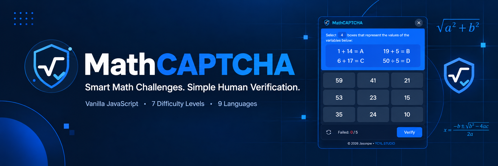
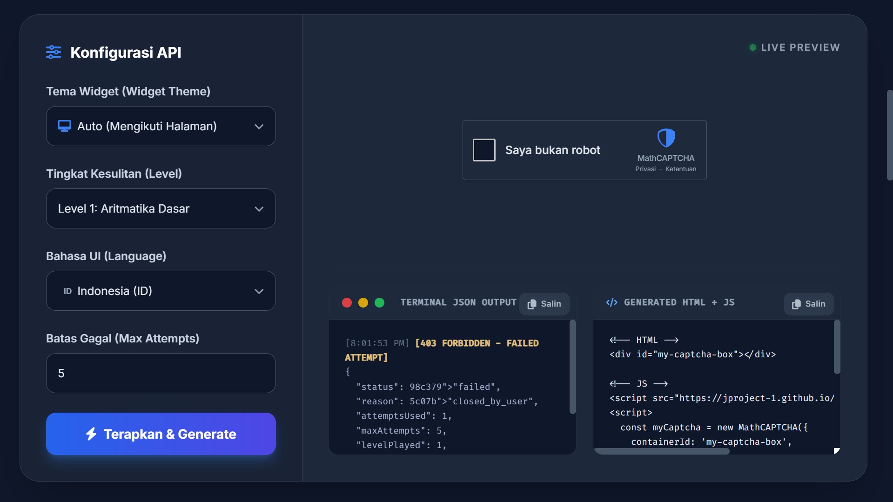

<div align="center">
  

  <p><strong>A modern, dynamic, multilingual math-based CAPTCHA widget for the web.</strong></p>

  <p>
    <a href="https://jproject-1.github.io/captcha-math/"></a>
    
    
    
    
  </p>

  <p>
    <a href="https://jproject-1.github.io/captcha-math/">Live Demo &amp; Documentation</a> ·
    <a href="#quick-start">Quick Start</a> ·
    <a href="#configuration">Configuration</a> ·
    <a href="#security-notes">Security Notes</a>
  </p>
</div>

---

## Table of Contents

- [Overview](#overview)
- [Features](#features)
- [Interface Preview](#interface-preview)
- [Important Security Disclaimer](#important-security-disclaimer)
- [Requirements](#requirements)
- [Quick Start](#quick-start)
- [Difficulty Levels](#difficulty-levels)
- [Languages](#languages)
- [Themes](#themes)
- [Configuration](#configuration)
- [Callback API](#callback-api)
  - [`onSuccess`](#onsuccess)
  - [`onFail`](#onfail)
  - [`onBlocked`](#onblocked)
  - [Understanding the client-side token](#understanding-the-client-side-token)
- [Verification Flow](#verification-flow)
- [Security Notes](#security-notes)
- [Privacy](#privacy)
- [Terms of Use](#terms-of-use)
- [License](#license)
- [Author and Maintainer](#author-and-maintainer)
- [Links](#links)

## Overview

**MathCAPTCHA** is a lightweight, client-side CAPTCHA widget that uses dynamically generated mathematical challenges as a human-verification mechanism. Instead of image-based CAPTCHA challenges, it presents mathematical problems across multiple difficulty levels, from basic arithmetic to calculus.

Built with **Vanilla JavaScript (ES6)**, MathCAPTCHA can be integrated into a standard HTML page without requiring a frontend framework.

> **Live Demo & Documentation:** <https://jproject-1.github.io/captcha-math/>

## Features

- **Dynamic mathematical challenges** — generates questions dynamically and supports multiple categories of mathematical problems.
- **7 difficulty levels** — spans basic arithmetic, roots and powers, algebra, trigonometry, probability and expectation, vectors, and calculus.
- **Random difficulty** — set `level: 'random'` to choose a challenge from the available levels.
- **9 interface languages** — Indonesian, English, Spanish, Chinese, Japanese, Russian, French, Arabic, and Hindi.
- **Automatic language detection** — `auto-web` detects language from the browser/web environment; `auto-user` supports user-oriented language detection according to the implementation logic.
- **Light and dark themes** — supports `light`, `dark`, and `auto` modes.
- **Vanilla JavaScript** — no frontend framework is required.
- **Callback API** — receive events for successful verification, failed attempts, and client-side blocked states.
- **Client-side verification token** — a token may be returned after success for application-specific handling. It is **not** a cryptographically secure proof of verification.

## Interface Preview

The following is a **design concept for documentation layout**, not a screenshot captured from the live widget. Replace it with a genuine screenshot of the deployed demo when the demo is accessible.

<p align="center">
  
</p>

To add a genuine screenshot:

1. Open the [live demo](https://jproject-1.github.io/captcha-math/) in a browser.
2. Capture the widget in a representative state (ideally show the challenge, answer field, and verification control).
3. Save the image as `assets/demo-screenshot.png`.
4. Replace the concept image above with `assets/demo-screenshot.png` and remove the concept disclaimer.

## Important Security Disclaimer

> [!WARNING]
> **MathCAPTCHA is intended for entertainment, educational purposes, experimentation, and lightweight human verification. It is not designed to provide strong protection against sophisticated bots or automated attacks.**

Do not treat MathCAPTCHA alone as a complete security solution for large-scale websites, official services, banking or financial systems, authentication systems, administrative systems, high-value transactions, or systems requiring strong anti-bot protection.

A determined user may inspect, modify, or bypass client-side JavaScript. For stronger protection, combine it with server-side validation, rate limiting, authentication controls, abuse prevention, or a dedicated anti-bot service. The developer integrating MathCAPTCHA is responsible for determining whether it is appropriate for the application's threat model.

## Requirements

- HTML5
- JavaScript enabled
- A modern web browser

No frontend framework is required.

## Quick Start

### 1. Create an HTML5 document

```html
<!DOCTYPE html>
<html lang="en">
<head>
  <meta charset="UTF-8">
  <meta name="viewport" content="width=device-width, initial-scale=1.0">
  <title>MathCAPTCHA Example</title>
</head>
<body>
  <div id="my-captcha-box"></div>
  <script src="https://jproject-1.github.io/captcha-math/api.js"></script>
  <script>
    const myCaptcha = new MathCAPTCHA({
      containerId: 'my-captcha-box',
      mode: 'auto',
      language: 'id',
      level: 'random',
      maxAttempts: 5,
      onSuccess: (response) => {
        console.log('Verification successful:', response);
        // Handle response.data.token according to your own application flow.
      },
      onFail: (response) => {
        console.log('Verification failed:', response);
      },
      onBlocked: (response) => {
        console.log('Maximum attempts reached:', response);
      }
    });
  </script>
</body>
</html>
```

### 2. Add the CAPTCHA container

The widget is rendered into the element whose ID is configured through `containerId`:

```html
<div id="my-captcha-box"></div>
```

### 3. Include and initialize MathCAPTCHA

Load `api.js` before creating the `MathCAPTCHA` instance. Use a valid container ID and choose the language, theme, difficulty, attempt limit, and callback functions appropriate to your page.

## Difficulty Levels

MathCAPTCHA provides **7 mathematical difficulty levels**:

| Level | Category | Description |
| ---: | --- | --- |
| `1` | Basic Arithmetic | Basic arithmetic operations. |
| `2` | Roots & Powers | Problems involving roots and powers. |
| `3` | Basic Algebra | Algebraic expressions and equations. |
| `4` | Trigonometry | Trigonometric problems and calculations. |
| `5` | Probability & Expectation | Probability and expected-value problems. |
| `6` | Vectors | Vector problems involving dot products. |
| `7` | Calculus | Calculus problems involving derivatives. |
| `random` | All Levels | Randomly selects a challenge from the available levels. |

Use a specific difficulty:

```javascript
const captcha = new MathCAPTCHA({
  containerId: 'my-captcha-box',
  level: 4
});
```

Or select randomly:

```javascript
const captcha = new MathCAPTCHA({
  containerId: 'my-captcha-box',
  level: 'random'
});
```

## Languages

MathCAPTCHA currently supports **9 interface languages**:

| Code | Language |
| --- | --- |
| `id` | Indonesian |
| `en` | English |
| `es` | Spanish |
| `zh` | Chinese |
| `ja` | Japanese |
| `ru` | Russian |
| `fr` | French |
| `ar` | Arabic |
| `hi` | Hindi |

### Manual language selection

```javascript
const captcha = new MathCAPTCHA({
  containerId: 'my-captcha-box',
  language: 'id'
});
```

### Automatic language detection

The documented automatic modes are:

- `auto-web`
- `auto-user`

These modes choose a suitable language according to the implementation's language-detection logic.

## Themes

MathCAPTCHA supports three display modes:

| Mode | Description |
| --- | --- |
| `light` | Light theme. |
| `dark` | Dark theme. |
| `auto` | Automatically adapts to the user's preferred theme. |

Example:

```javascript
const captcha = new MathCAPTCHA({
  containerId: 'my-captcha-box',
  mode: 'dark'
});
```

## Configuration

Pass a configuration object to `new MathCAPTCHA({...})`.

| Parameter | Type | Default | Description |
| --- | --- | --- | --- |
| `containerId` | `String` | `null` | **Required.** ID of the HTML element where MathCAPTCHA will be rendered. |
| `mode` | `String` | `'auto'` | Display mode: `'light'`, `'dark'`, or `'auto'`. |
| `language` | `String` | `'auto-web'` | Interface language: `id`, `en`, `es`, `zh`, `ja`, `ru`, `fr`, `ar`, `hi`, `auto-web`, or `auto-user`. |
| `level` | `Integer \| String` | `'random'` | Difficulty from `1` to `7`, or `'random'`. |
| `maxAttempts` | `Integer` | `5` | Maximum failed attempts before the current instance enters the blocked state. |
| `onSuccess` | `Function` | — | Called when the user successfully solves the challenge. |
| `onFail` | `Function` | — | Called on a failed attempt, including when the CAPTCHA is closed by the user. |
| `onBlocked` | `Function` | — | Called when the maximum number of attempts is reached. |

## Callback API

MathCAPTCHA provides three primary callbacks: `onSuccess`, `onFail`, and `onBlocked`.

### `onSuccess`

Called when the user solves the challenge successfully.

```javascript
onSuccess: (response) => {
  console.log('Success:', response);
}
```

Example response:

```json
{
  "status": "success",
  "data": {
    "levelPlayed": 4,
    "attemptsUsed": 2,
    "timestamp": "2026-08-24T12:00:00.000Z",
    "token": "..."
  }
}
```

#### Understanding the client-side token

The `token` returned by `onSuccess` is generated on the client side. It is based on encoded verification information (including values such as verification state, timestamp, and level) using `btoa(...)`.

Conceptually:

```text
verification state + timestamp + level
                  ↓
                btoa()
                  ↓
                 token
```

> [!CAUTION]
> Base64 encoding is not encryption and does not provide cryptographic authenticity by itself. **Do not treat this token as a cryptographically secure proof of verification.** If stronger protection is required, implement your own server-side validation and security mechanism.

### `onFail`

Called when a verification attempt fails. This includes an incorrect answer and closing/cancelling the CAPTCHA.

```javascript
onFail: (response) => {
  console.log('Verification failed:', response);
}
```

Example response:

```json
{
  "status": "failed",
  "reason": "wrong_answer",
  "attemptsUsed": 1,
  "maxAttempts": 5,
  "levelPlayed": 4,
  "timestamp": "2026-08-24T12:00:00.000Z"
}
```

Depending on the event, `reason` may indicate why verification failed, for example:

```text
wrong_answer
closed_by_user
```

### `onBlocked`

Called after the user reaches the configured `maxAttempts` limit.

```javascript
onBlocked: (response) => {
  console.log('CAPTCHA blocked:', response);
}
```

Example response:

```json
{
  "status": "blocked",
  "reason": "wrong_answer",
  "attemptsUsed": 5,
  "maxAttempts": 5,
  "levelPlayed": 4,
  "timestamp": "2026-08-24T12:00:00.000Z"
}
```

#### What does “blocked” mean?

The `blocked` state applies to the current client-side CAPTCHA instance. After the configured attempt limit is reached, the user must refresh the page to start that instance again. This does **not** permanently block the user from the website.

MathCAPTCHA itself does not provide account-level, IP-level, or server-side blocking. Persistent blocking must be implemented by the integrating application's backend.

## Verification Flow

```text
CAPTCHA starts
      |
      v
Generate math challenge
      |
      v
User submits answer
      |
  +---+---+
  |       |
Wrong   Correct
  |       |
  v       v
onFail() onSuccess()
  |
  v
Attempts remaining?
  |
  +------ No ------> onBlocked()
  |                     |
 Yes                    v
  |                Refresh page
  v
Retry
```

## Security Notes

MathCAPTCHA runs primarily on the client side. The JavaScript code, challenge generation, and verification process can potentially be inspected or modified by the user. It should therefore **not be treated as a complete security boundary**.

For security-sensitive applications, consider combining it with:

- Server-side validation
- Rate limiting and request throttling
- Authentication and session validation
- Abuse detection
- IP/device controls where appropriate
- A dedicated anti-bot service

Choose controls according to the application's requirements and threat model.

## Privacy

### Personal data collection

MathCAPTCHA itself does not intentionally collect, store, track, or share personal information such as IP addresses, user location, user profiles, browsing history, or personal identification information as part of its CAPTCHA functionality.

The website or application integrating MathCAPTCHA may independently collect data through its backend, hosting provider, analytics services, cookies, CDN, or other third-party services. Those services are outside the scope of MathCAPTCHA itself.

### How MathCAPTCHA works

MathCAPTCHA generates mathematical challenges dynamically and validates the user's answer within the widget. The project does not intentionally send user activity logs to third-party analytics or marketing services as part of the CAPTCHA functionality.

### Cookies and browser storage

MathCAPTCHA does not use tracking cookies, advertising cookies, `localStorage`, or `sessionStorage` for its CAPTCHA functionality. CAPTCHA state is handled by the application running in the browser and does not require persistent browser storage.

### Third-party services

The hosted script may be loaded from:

```text
https://jproject-1.github.io/captcha-math/
```

Consider the privacy policies and infrastructure of any external hosting or services used by the integrating application.

## Terms of Use

By using or integrating MathCAPTCHA, you acknowledge that:

1. MathCAPTCHA is provided as open-source software.
2. It is primarily intended for educational, experimental, entertainment, and lightweight verification purposes.
3. It is not a complete anti-bot security solution.
4. You are responsible for evaluating the software before deploying it.
5. You are responsible for adding further security mechanisms when required.
6. You are responsible for complying with applicable laws and regulations.
7. You are responsible for the security and privacy practices of the application in which it is integrated.

## License

MathCAPTCHA is released under the **MIT License**.

**Copyright © 2026 Jasonpw**

```text
MIT License

Copyright (c) 2026 Jasonpw

Permission is hereby granted, free of charge, to any person obtaining a copy
of this software and associated documentation files (the "Software"), to deal
in the Software without restriction, including without limitation the rights
to use, copy, modify, merge, publish, distribute, sublicense, and/or sell
copies of the Software, and to permit persons to whom the Software is
furnished to do so, subject to the following conditions:

The above copyright notice and this permission notice shall be included in all
copies or substantial portions of the Software.

THE SOFTWARE IS PROVIDED "AS IS", WITHOUT WARRANTY OF ANY KIND, EXPRESS OR
IMPLIED, INCLUDING BUT NOT LIMITED TO THE WARRANTIES OF MERCHANTABILITY,
FITNESS FOR A PARTICULAR PURPOSE AND NONINFRINGEMENT. IN NO EVENT SHALL THE
AUTHORS OR COPYRIGHT HOLDERS BE LIABLE FOR ANY CLAIM, DAMAGES OR OTHER
LIABILITY, WHETHER IN AN ACTION OF CONTRACT, TORT OR OTHERWISE, ARISING FROM,
OUT OF OR IN CONNECTION WITH THE SOFTWARE OR THE USE OR OTHER DEALINGS IN THE
SOFTWARE.
```

## Author and Maintainer

- **Author:** [Jasonpw](https://jasonpw.web.id/)
- **Maintainer:** [YCYL STUDIO](https://ycylstudio.web.id/)

## Links

- **Live Demo & Documentation:** <https://jproject-1.github.io/captcha-math/>
- **Author:** <https://jasonpw.web.id/>
- **YCYL STUDIO:** <https://ycylstudio.web.id/>

Issues, suggestions, and improvements are welcome through the project's available communication channels.

---

<div align="center">
  <sub>MathCAPTCHA · Lightweight mathematical verification for the web · MIT License</sub>
</div>
